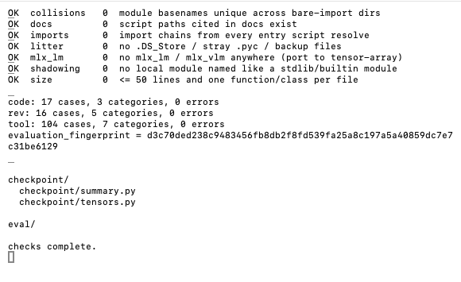

# Model Surgery

Inspect and transform trained safetensors checkpoints through a modular CLI.
Weight operations use MLX; local runtime integration uses configured commands and
an OpenAI-compatible HTTP protocol. Backend names do not determine capabilities.



## Run locally

```sh
python3 pipeline/cli/ms.py list
python3 pipeline/cli/ms.py doctor
python3 pipeline/cli/ms.py runtime
python3 pipeline/cli/ms.py privacy
python3 tests/run.py
```

## Documentation

- [CLI and evidence](docs/cli.md)
- [Surgery operations](docs/surgery.md), [pruning + compression](docs/pruning.md), [merging](docs/merging.md)
- [GGUF editing](docs/gguf.md)
- [Profiling](docs/profile.md)
- [Modular checkpoint storage](docs/storage/overview.md)
- [Runtime adapters and private configuration](docs/runtime.md)
- [Healing](docs/healing.md), [evaluation](docs/evaluation.md), [export](docs/export.md)
- [Environment and dependencies](docs/environment.md), [workspace layout](docs/workspace.md)
- [Performance: speed, memory, sparse kernel](docs/performance.md)
- [Audit results and limitations](docs/audit.md)

## Acceptance limits

Follow profile → surgery → heal → export. Per-layer profiling runs through runtime probe
routes ([profile](docs/profile.md)); in-process stubs stay fail-closed. Tests on small synthetic checkpoints
establish transformation behavior, not real-model quality or promotion readiness.
Dense-to-MoE conversion (Qwen3 dense → Qwen3MoE) fits routers on captured MLP inputs;
all-experts output matches dense, sparse top-K loses quality until healed ([details](docs/moefy.md)). Structured tool-call training requires a capable runtime adapter.
DARE, TIES (trim + sign election + disjoint mean) and DARE-TIES merges are implemented. GGUF layer and expert
pruning are implemented ([docs](docs/gguf.md)); PyTorch checkpoint editing, dynamic expert
loading, and promotion-grade eval are absent.

Python 3.11+ is required. No `mlx_lm` or `mlx_vlm`. Double-click `clean.command`
to remove generated Python caches. Existing checkpoints are never edited in place.

## License

MIT
